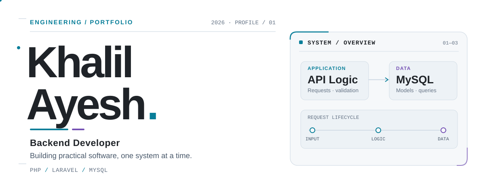
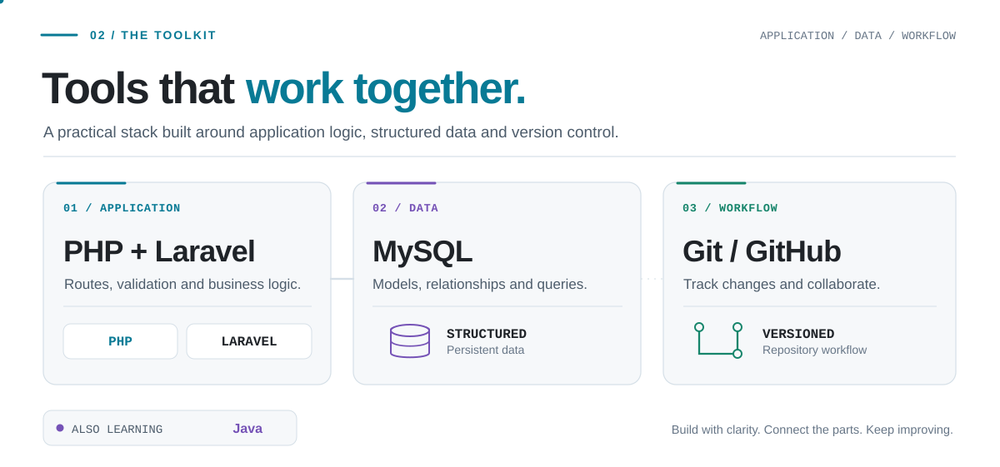

  <picture>
    <source media="(prefers-color-scheme: dark)" srcset="./assets/editorial-hero-dark.svg" />
    <source media="(prefers-color-scheme: light)" srcset="./assets/editorial-hero-light.svg" />
    
  </picture>

 

  <picture>
    <source media="(prefers-color-scheme: dark)" srcset="./assets/about-github-dark.svg" />
    <source media="(prefers-color-scheme: light)" srcset="./assets/about-github-light.svg" />
    
  </picture>

 

  <code>BACKEND DEVELOPMENT</code>
  &nbsp;&nbsp;
  <code>ALWAYS LEARNING</code>

 

<h3 align="center">What I’m Exploring</h3>

  <picture>
    <source media="(prefers-color-scheme: dark)" srcset="./assets/focus-github-dark.svg" />
    <source media="(prefers-color-scheme: light)" srcset="./assets/focus-github-light.svg" />
    
  </picture>

 

  <picture>
    <source media="(prefers-color-scheme: dark)" srcset="./assets/editorial-stack-dark.svg" />
    <source media="(prefers-color-scheme: light)" srcset="./assets/editorial-stack-light.svg" />
    
  </picture>

 

  <picture>
    <source media="(prefers-color-scheme: dark)" srcset="./assets/how-i-build-github-dark.svg" />
    <source media="(prefers-color-scheme: light)" srcset="./assets/how-i-build-github-light.svg" />
    
  </picture>

 

  <picture>
    <source media="(prefers-color-scheme: dark)" srcset="./assets/editorial-projects-dark.svg" />
    <source media="(prefers-color-scheme: light)" srcset="./assets/editorial-projects-light.svg" />
    
  </picture>

 

  <picture>
    <source media="(prefers-color-scheme: dark)" srcset="./assets/mizan-ui-evidence-github-dark.svg" />
    <source media="(prefers-color-scheme: light)" srcset="./assets/mizan-ui-evidence-github-light.svg" />
    
  </picture>

Screen-based illustration. The actual application screenshots are shared separately for review.

