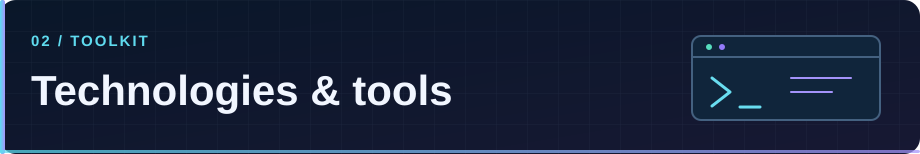
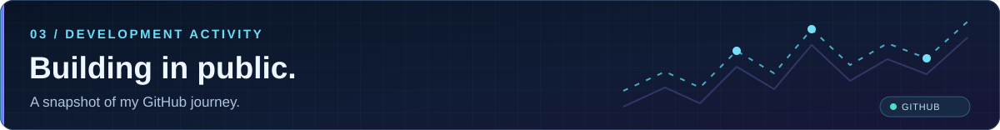
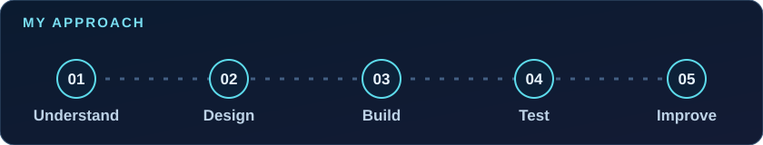
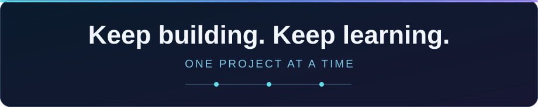

  

 

  <a href="#about-me">About</a> &nbsp;•&nbsp;
  <a href="#areas-im-exploring">Focus</a> &nbsp;•&nbsp;
  <a href="#tech-stack">Stack</a> &nbsp;•&nbsp;
  <a href="#selected-work">Projects</a> &nbsp;•&nbsp;
  <a href="#github-activity">Activity</a> &nbsp;•&nbsp;
  <a href="#connect">Connect</a>

 

  
  &nbsp;
  

 

### About me

Hey, I'm **Khalil** 👋

I'm a **backend-focused developer** who enjoys learning how things work behind the scenes. I build projects to turn ideas into practical solutions, and I keep learning through every new challenge.

I'm especially interested in **server-side logic, APIs, and data-driven applications**. My goal is simple: write clearer code, understand systems better, and improve one project at a time.

Currently focused on learning, building, debugging, and getting the fundamentals right.

 

### Areas I'm exploring

  

 

### Tech stack

  

 

**BACKEND & LANGUAGES**

 

  

**DATABASES**

 

  

**VERSION CONTROL & WORKFLOW**

 

  

Tools I'm learning and using — not a claim of expert-level proficiency.

 

### Selected work

  

I'm preparing **documented, publicly shareable project examples** that explain the problem, technologies, backend structure, and what I learned. Until they're ready, you can explore the repositories I've made public.

  

 

### GitHub activity

  

 

  
  &nbsp;
  

 

  

  Live cards use public third-party services and may occasionally be unavailable. <a href="https://github.com/khalilayesh6?tab=overview">View activity directly on GitHub →</a>

 

### How I build

  

 

I try to understand the problem first, plan the data and behavior, implement the solution, test it, and improve what I can. **Progress over perfection.**

 

### Connect

I enjoy learning from other developers, exploring interesting projects, and improving through practice. Feel free to check out my repositories and follow my journey.

  
  &nbsp;
  

 

  

